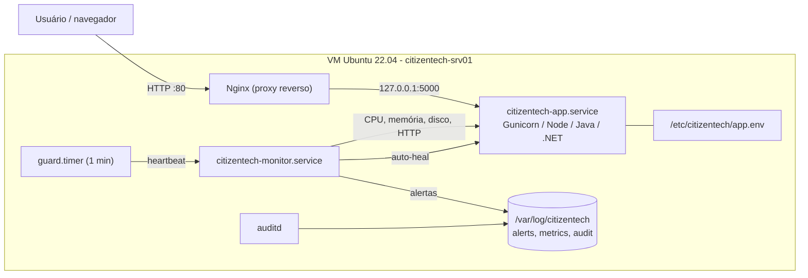

# CitizenTech · Provisionamento automatizado em Linux

Projeto de **Operating Systems** (Global Solution). Um único comando cria a infraestrutura de uma VM Linux, instala e configura a aplicação web **CitizenTech**, liga o monitoramento com alertas e registra tudo em logs de auditoria. Nada é feito à mão.

```bash
sudo ./provision.sh
```

---

## 1. O percurso da equipe

| Etapa do enunciado | O que este projeto faz | Script |
|---|---|---|
| **01 · Preparar o ambiente** | Prepara a VM Ubuntu do zero para receber qualquer app web (Python, Node, Java, .NET ou estático). | `provision.sh` + `Vagrantfile` |
| **02 · A aplicação hospedada** | Baixa o código, detecta a stack, instala dependências, gera variáveis de ambiente, cria o serviço e publica no Nginx. | `scripts/02-app.sh` |
| **03 · A infraestrutura** | Configura rede/IP, DNS, hostname, firewall, monitoramento e auditoria. | `scripts/01-infra.sh`, `03-monitoring.sh`, `04-audit.sh` |
| **04 · Resultados e conclusão** | Valida tudo de ponta a ponta (checklist PASS/FAIL) e salva evidências técnicas. | `scripts/05-validate.sh` |

## 2. Atendimento aos critérios de avaliação (10 pts)

| Critério | Pts | Onde está |
|---|---|---|
| Script de provisionamento de infra (redes, DNS, IP) | 2 | `scripts/01-infra.sh`: hostname + FQDN, `/etc/hosts`, IP DHCP ou **estático via netplan**, DNS via `systemd-resolved`, teste de resolução, fuso/NTP, firewall UFW |
| Script de provisionamento da aplicação (dependências, configurações, orquestração) | 2 | `scripts/02-app.sh`: detecção da stack, runtimes e dependências, `/etc/citizentech/app.env`, serviço `systemd`, Nginx como proxy reverso e health check. `provision.sh` orquestra as etapas na ordem. |
| Script de monitoramento com alertas de CPU, Disco e Memória | 2 | `monitoring/citizentech-monitor.sh`: limites de aviso e crítico, alerta de recuperação, cooldown anti-spam, alertas em arquivo + syslog + `wall` + webhook (Teams/Slack/Discord); também checa serviços e HTTP |
| Monitoramento como serviço tolerante a falhas | 1 | `systemd/citizentech-monitor.service` (`Restart=always`, sem limite de reinícios, `OOMScoreAdjust=-900`, habilitado no boot) + **guardião** `citizentech-monitor-guard.timer`, que reinicia o monitor se ele travar (heartbeat). O monitor também faz *auto-heal* da aplicação e do Nginx. |
| Logs de auditoria e execução dos scripts | 1 | `scripts/lib/common.sh` grava cada etapa em `/var/log/citizentech/provision.log` (execução) e `/var/log/citizentech/audit.log` (quem, quando, o quê, OK/FAIL, duração). `04-audit.sh` configura o **auditd**, deixa o journald persistente, ativa a rotação de logs e gera o relatório. |
| Funcionamento completo da proposta | 2 | `scripts/05-validate.sh`: 19 verificações automáticas + evidências em `evidencias/<data>/` |

## 3. Arquitetura



## 4. Estrutura do repositório

```
.
├── provision.sh                 # orquestrador (executa 01 → 05)
├── Vagrantfile                  # VM Ubuntu 22.04 provisionada automaticamente
├── config/
│   ├── citizentech.conf         # TODAS as variáveis (rede, app, limites de alerta)
│   └── app.env.example          # modelo das variáveis de ambiente da aplicação
├── scripts/
│   ├── lib/common.sh            # logs, auditoria, tratamento de erro
│   ├── 01-infra.sh              # rede, IP, DNS, hostname, firewall, NTP
│   ├── 02-app.sh                # dependências, configuração, serviço, Nginx
│   ├── 03-monitoring.sh         # instala o monitor como serviço + teste de falha
│   ├── 04-audit.sh              # auditd, journald, logrotate, relatório
│   └── 05-validate.sh           # checklist + coleta de evidências
├── monitoring/
│   ├── citizentech-monitor.sh   # monitor de CPU/Memória/Disco/serviços/HTTP
│   └── citizentech-monitor-guard.sh
├── systemd/                     # units do monitor e do guardião
├── tools/simulate-load.sh       # provoca falhas e carga para a demonstração
├── app/                         # app CitizenTech de exemplo (Flask)
├── docs/roteiro-video.md        # roteiro do vídeo de 7 minutos
└── evidencias/                  # saídas geradas pelo 05-validate.sh
```

## 5. Como executar

### Opção A: Vagrant + VirtualBox (recomendado, 100% automático)

```bash
git clone <este-repositorio> && cd <este-repositorio>
vagrant up            # cria a VM e roda ./provision.sh sozinho
```
Acesse **http://localhost:8080** ou **http://192.168.56.10**. Para repetir o provisionamento, rode `vagrant provision` (os scripts são idempotentes).

### Opção B: VM Ubuntu 22.04/24.04 já existente

```bash
sudo apt-get update && sudo apt-get install -y git
git clone <este-repositorio> && cd <este-repositorio>
sudo ./provision.sh                    # tudo
sudo ./provision.sh infra app          # só algumas etapas
```

Etapas disponíveis: `infra`, `app`, `monitor`, `audit` e `validate`.

## 6. Usando a aplicação da outra disciplina

Edite `config/citizentech.conf` (ou passe as variáveis na linha de comando). A stack é detectada automaticamente pelos arquivos do projeto:

| Arquivo encontrado | Stack | Como sobe |
|---|---|---|
| `pom.xml` / `build.gradle` | Java (Spring Boot) | `mvn package` → `java -jar ... --server.port=$APP_PORT` |
| `*.csproj` | .NET | `dotnet publish` → `dotnet App.dll` (via `ASPNETCORE_URLS`) |
| `requirements.txt` / `pyproject.toml` | Python | venv + `pip install` → Gunicorn (`PYTHON_WSGI=app:app`) |
| `package.json` | Node.js | NodeSource + `npm ci` → `npm start` (lê `PORT`) |
| `index.html` | Estático / SPA | Nginx serve `dist/`, `build/` ou `public/` |

Exemplos:

```bash
# Spring Boot que está na pasta backend/ de outro repositório
sudo APP_SOURCE=git APP_REPO_URL=https://github.com/equipe/citizentech-java.git \
     APP_SUBDIR=backend APP_PORT=8080 APP_HEALTH_PATH=/actuator/health ./provision.sh

# Front-end React/Vite (build gerado e servido pelo Nginx)
sudo APP_SOURCE=git APP_REPO_URL=https://github.com/equipe/citizentech-web.git \
     APP_TYPE=static APP_BUILD_CMD="npm run build" ./provision.sh

# API Node que não tem /health
sudo APP_SOURCE=git APP_REPO_URL=https://github.com/equipe/citizentech-api.git APP_HEALTH_PATH=/ ./provision.sh
```

`config/app.env.example` é o modelo versionado (sem segredos). Segredos reais (URL de banco, chaves de API) vão direto em `/etc/citizentech/app.env` na VM. Esse arquivo tem permissão `640` e os valores que já estão no servidor são preservados quando o provisionamento roda de novo.

## 7. Monitoramento e alertas

| Recurso | Aviso | Crítico | Ação |
|---|---|---|---|
| CPU | 70% | 90% | alerta + recuperação |
| Memória | 75% | 90% | alerta + recuperação |
| Disco (`/`) | 80% | 90% | alerta + recuperação |
| Serviços (`citizentech-app`, `nginx`) | – | parado | alerta + **reinício automático** |
| HTTP `/health` | – | falha | alerta |

Os limites e o intervalo ficam em `config/citizentech.conf` e são gravados em `/etc/citizentech/monitor.conf`. Depois de editar, rode `systemctl reload citizentech-monitor`.

Onde aparecem os alertas:

- `/var/log/citizentech/alerts.log`: um alerta por linha.
- `/var/log/citizentech/metrics.log`: histórico de coletas.
- `journalctl -t citizentech-monitor`: syslog, com prioridade `crit` ou `warning`.
- `wall`: alertas críticos aparecem no terminal de quem estiver logado.
- Webhook: preencha `ALERT_WEBHOOK_URL` com a URL de entrada do Teams, Slack ou Discord.

```bash
citizentech-monitor --status       # últimas métricas, alertas e heartbeat
citizentech-monitor --once         # uma coleta agora
```

### Tolerância a falhas

| Falha | Quem recupera | Como demonstrar |
|---|---|---|
| Monitor morto (`kill -9`, crash) | systemd, com `Restart=always` em 5 s | `sudo ./tools/simulate-load.sh kill-monitor` |
| Monitor travado (sem heartbeat) | guardião (`timer` a cada 1 min) | `sudo ./tools/simulate-load.sh hang-monitor` |
| Aplicação ou Nginx parados | auto-heal do monitor + `Restart=always` | `sudo ./tools/simulate-load.sh stop-app` |
| Falta de memória | `OOMScoreAdjust=-900` (o kernel mata outros processos antes do monitor) | – |
| Reboot da VM | todos os serviços habilitados no boot | `sudo reboot` |

Para gerar carga e ver os alertas: `sudo ./tools/simulate-load.sh cpu 60`, `mem 60` ou `disk 30`.

## 8. Logs de auditoria e execução

| Arquivo | Conteúdo |
|---|---|
| `/var/log/citizentech/provision.log` | Execução detalhada: cada comando executado e a saída dele |
| `/var/log/citizentech/audit.log` | Trilha de auditoria: `data\|run\|user\|sudo_user\|host\|script\|action\|status\|detail` |
| `/var/log/citizentech/relatorio-auditoria-*.txt` | Relatório consolidado (`sudo ./scripts/04-audit.sh --report`) |
| `auditd` (`ausearch -k ct_config -i`) | Quem alterou rede, DNS, Nginx, serviços, `app.env` e usuários |
| `journalctl -t citizentech-provision` | As mesmas mensagens dos scripts, no journal persistente |

Os logs passam por rotação diária, com 14 dias de retenção e compressão (`/etc/logrotate.d/citizentech`).

```bash
grep 'status=FAIL' /var/log/citizentech/audit.log           # falhas
grep 'run=<RUN_ID>' /var/log/citizentech/audit.log          # uma execução inteira
sudo aureport -k -i --summary                               # resumo do auditd
```

## 9. Evidências técnicas

`sudo ./provision.sh validate` (ou `sudo ./scripts/05-validate.sh`) cria `evidencias/<data-hora>/` com o checklist e as saídas de `hostnamectl`, `ip`, `resolvectl`, `ufw`, `systemctl status`, `curl`, métricas, alertas, auditoria e `auditd`. Faça commit dessa pasta junto com o repositório.

## 10. Solução de problemas

| Sintoma | Verifique |
|---|---|
| Etapa falhou | A mensagem mostra a etapa, a linha e as últimas linhas de `provision.log` |
| App não sobe | `journalctl -u citizentech-app -n 50` · confira `APP_PORT` e `APP_HEALTH_PATH` |
| 502 Bad Gateway | o app precisa escutar em `127.0.0.1:$APP_PORT` (use as variáveis `PORT`/`SERVER_PORT`) |
| DNS falha | `resolvectl status` · troque `DNS_SERVERS` |
| IP estático sem rede | use `NET_MODE=static` apenas na interface *host-only* (`NET_IFACE`) |

---
**Integrantes:** _preencher nome e RM_
